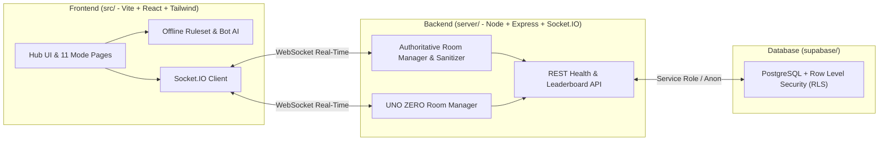

# UNO GAME HUB (`uno-zero`)

Koleksi game kartu UNO digital berbasis web untuk Desktop dan Mobile (PWA), mencakup **11 mode permainan UNO** (mulai dari **UNO Classic**, **UNO Flip!**, **UNO All Wild**, **UNO Show 'Em No Mercy**, **UNO Flex**, **UNO Zero**, **UNO Teams**, **UNO Party!**, **Liar's UNO**, **DOS Mode**, hingga **ONO 99**) dengan dukungan **VS Bot AI**, **Pass & Play Lokal**, dan **Multiplayer Online Real-Time** (*server-authoritative*).

> **Demo Live:** `[Tambahkan URL Demo di sini, mis. https://uno-zero.vercel.app]`

## Screenshot

| Beranda (11 Mode) | Meja Permainan & Radial Wild Picker | Podium & Fun Stats |
|---|---|---|
| `` | `` | `` |

---

## Fitur Utama

- **11 Mode UNO Lengkap:** Setiap mode memiliki aturan resmi, tema meja felt, desain punggung kartu, dan signature HUD masing-masing.
- **7 Add-On Expansion Packs (Khusus UNO Classic):** Reverse, Stack, Swap, Speed, Defense, Comeback, dan Frenemies Pack (16 kartu/pack) dengan validasi ketat khusus UNO Classic.
- **Multiplayer Online Anti-Cheat:** Pengocokan dek, validasi giliran, dan sanitasi kartu lawan 100% dijalankan oleh server (`Socket.IO`), lengkap dengan **Spectator Mode** (isi kartu pemain tersembunyi), **1-Klik Rematch**, dan **Quick Emotes**.
- **Ergonomi Desktop & Mobile (PWA):**
  - *Playable affordance* (kartu valid otomatis terangkat), *Auto-Sort* tangan, dan proteksi anti salah klik di mobile (tap 2 langkah / *swipe up*).
  - *Radial 4-Quadrant Wild Color Picker*, cincin arah putaran, *ambient glow* warna aktif, dan *circular turn timer*.
  - *Keyboard shortcuts* desktop (`ArrowLeft`/`ArrowRight`, `Enter`/`Space`, `D`, `U`), *Haptic Feedback*, *Safe Area* iOS/Android, dan **Mode Buta Warna** (*Colorblind Mode*).

---

## Arsitektur Sistem



- **`src/` (Frontend):** Aplikasi React 19 + TypeScript + Tailwind CSS v4 + Framer Motion. Menangani tampilan, mode offline/AI, PWA, audio Web Audio API, dan koneksi `socket.io-client`.
- **`server/` (Backend):** Server Node.js authoritative berbasis Express + Socket.IO. Menangani room lifecycle, validasi aksi, anti-cheat card hiding (termasuk Spectator Mode), timer giliran, dan broadcast real-time.
- **`supabase/` (Database):** Skema PostgreSQL untuk profil pemain (guest yang dapat di-upgrade), riwayat pertandingan, dan global leaderboard dengan kebijakan **Row Level Security (RLS)**.

---

## Instalasi & Menjalankan Secara Lokal

### Prasyarat
- Node.js `>= 20.0.0`
- npm `>= 10`

### Langkah Setup

1. **Clone repositori & instal dependensi:**
   ```bash
   git clone https://github.com/anggakakul/uno-zero.git
   cd uno-zero
   npm install
   ```

2. **Salin konfigurasi environment:**
   ```bash
   cp .env.example .env
   ```
   Sesuaikan variabel di `.env`:
   - `VITE_SERVER_URL`: Kosongkan jika frontend & backend berjalan di domain yang sama, atau isi `http://localhost:3001` saat pengembangan lokal terpisah.
   - `PORT`: Port backend (default `3001`).
   - `CORS_ORIGINS`: Origin yang diizinkan (default `*` untuk lokal).
   - `SUPABASE_URL`, `SUPABASE_ANON_KEY`, `SUPABASE_SERVICE_ROLE_KEY`: Opsional untuk persistensi leaderboard & riwayat di Supabase (jalankan [supabase/schema.sql](supabase/schema.sql) di Supabase SQL Editor).

3. **Jalankan Frontend & Backend secara lokal:**
   ```bash
   # Terminal 1: Jalankan Frontend (Vite di http://localhost:5173)
   npm run dev:client

   # Terminal 2: Jalankan Backend Socket.IO (http://localhost:3001)
   npm run dev:server
   ```

---

## Skrip Tersedia

| Perintah | Fungsi |
|---|---|
| `npm run dev` / `npm run dev:client` | Menjalankan dev server frontend Vite (`src/`) |
| `npm run dev:server` | Menjalankan backend authoritative server (`server/`) |
| `npm run typecheck:client` | Typecheck TypeScript khusus frontend (`src/`) |
| `npm run typecheck:server` | Typecheck TypeScript khusus backend (`server/`) |
| `npm run typecheck` | Menjalankan typecheck frontend & backend sekaligus |
| `npm run build` / `npm run build:client` | Typecheck + build produksi frontend (`dist/`) |
| `npm test` | Menjalankan seluruh unit & integration test Vitest |
| `npm start` | Menjalankan server produksi (`tsx server/index.ts`) |

---

## Deployment

- **Backend & Fullstack:** Dikonfigurasi untuk **Railway** melalui `railway.json` (`npm run build` lalu `npm start`, healthcheck `/api/health`).
- **Frontend (opsional terpisah):** Dikonfigurasi untuk **Vercel** melalui `vercel.json` (set `VITE_SERVER_URL` ke URL backend Railway).

---

## Lisensi

Proyek ini dirilis di bawah lisensi [MIT](LICENSE).
